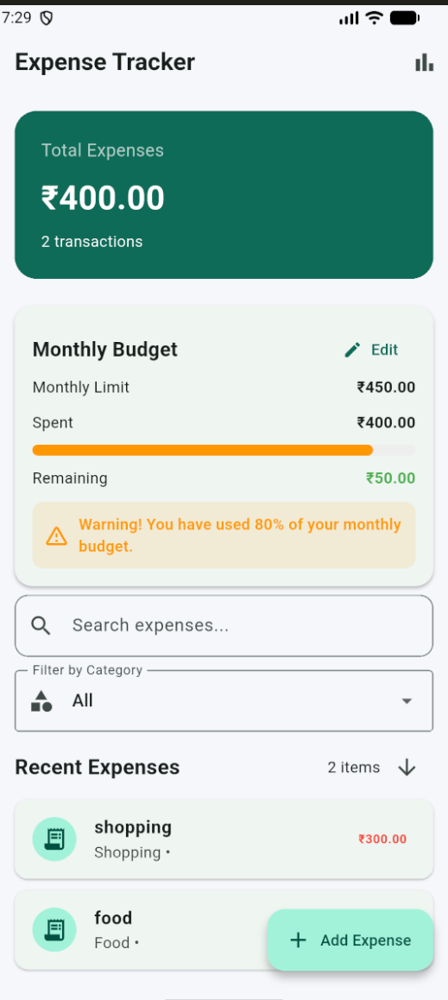
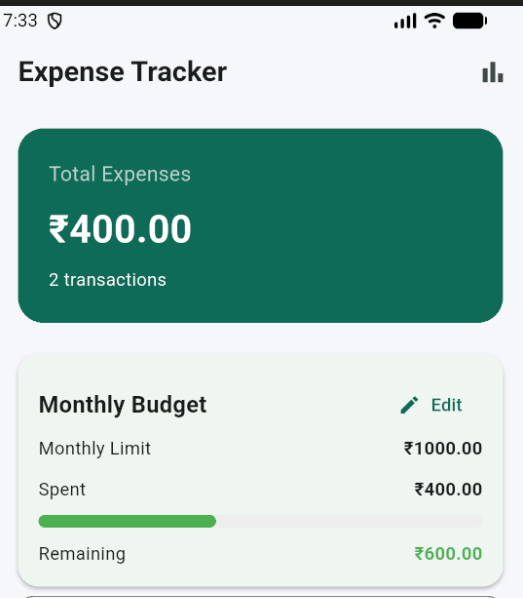
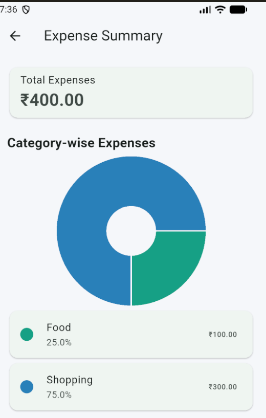
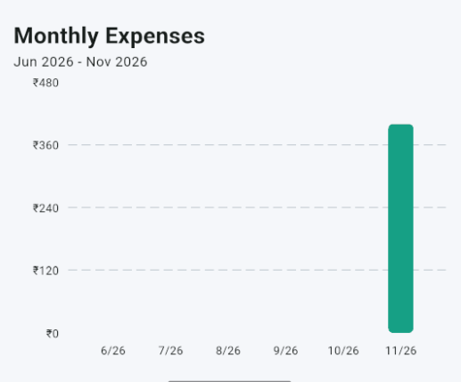

# 💰 Expense Tracker App

A simple and user-friendly **Expense Tracker Application** developed using Flutter. It helps users record daily expenses, manage monthly budgets, monitor spending, and visualize their financial activities through charts.

## 📌 Project Overview

Managing daily expenses is important for maintaining financial discipline. This Expense Tracker application provides an easy way to track expenses, organize spending by categories, and monitor monthly budgets.

The application stores expense data locally, allowing users to access their records even after closing and reopening the app.

## ✨ Features

- **Add Expenses:** Record expenses with details such as title, amount, category, and date.
- **View Expenses:** View all recorded expenses.
- **Edit Expenses:** Update existing expense details.
- **Delete Expenses:** Remove unwanted expense records.
- **Expense Details:** View individual expense information.
- **Local Storage:** Save expense data using SharedPreferences.
- **Monthly Budget:** Set and update a monthly spending limit.
- **Budget Tracking:** View total spending, remaining budget, and budget progress.
- **Budget Alerts:** Receive warnings when spending reaches 80% of the budget or exceeds the limit.
- **Search Expenses:** Search for specific expenses.
- **Category Filter:** Filter expenses based on categories.
- **Sorting:** Sort expenses by newest or oldest.
- **Expense Summary:** View category-wise spending.
- **Pie Chart:** Visualize expenses by category.
- **Monthly Bar Chart:** Compare expenses across the last six calendar months.

## 🛠️ Technologies Used

| Technology | Purpose |
|---|---|
| Flutter | Application development |
| Dart | Programming language |
| Provider | State management |
| SharedPreferences | Local data storage |
| fl_chart | Data visualization and charts |
| Android Studio | Emulator and Android development |
| Visual Studio Code | Code editor |
| Git | Version control |
| GitHub | Source code hosting |

## 📸 Application Screenshots

### 1. Home Screen
Displays total expenses and the main dashboard.



### 2. Monthly Budget
Displays monthly budget, spending, remaining balance, and budget progress.



### 3. Expense Summary
Displays category-wise expense analysis.



### 4. Monthly Expense Chart
Displays monthly expense comparisons using a bar chart.



## 📂 Project Structure

```text
expense_tracker/
│
├── android/
├── assets/
├── lib/
│   ├── main.dart
│   ├── models/
│   ├── providers/
│   ├── screens/
│   └── widgets/
│
├── screenshots/
│   ├── home_screen.png
│   ├── monthly_budget.png
│   ├── expense_summary.png
│   └── monthly_chart.png
│
├── test/
├── pubspec.yaml
├── pubspec.lock
└── README.md
```

*Note: The structure above shows the main project folders. Individual files may vary.*

## 🚀 How to Run the Project

### Prerequisites

- Flutter SDK
- Dart SDK
- Android Studio or Visual Studio Code
- Android Emulator or Android Device

### Installation Steps

**Step 1: Clone the repository**

```bash
git clone https://github.com/sivasai9492/expense-tracker.git
```

**Step 2: Navigate to the project folder**

```bash
cd expense-tracker
```

**Step 3: Install dependencies**

```bash
flutter pub get
```

**Step 4: Run the application**

```bash
flutter run
```

## 🧪 Testing

The project includes tests for expense analytics and application functionality.

Run the following command:

```bash
flutter test
```

To check the project for code issues:

```bash
flutter analyze
```

## 💾 Data Storage

The application uses **SharedPreferences** for local data storage.

It helps preserve expense records and monthly budget information even after the application is closed or restarted.

## 📊 Expense Analytics

The application provides visual insights into spending through:

- Category-wise expense distribution.
- Monthly expense comparison.
- Total monthly spending.
- Remaining monthly budget.
- Budget utilization percentage.

## 🎯 Project Objectives

- Develop a simple expense management application.
- Help users monitor their daily spending.
- Encourage better financial planning.
- Provide monthly budget tracking.
- Visualize spending patterns using charts.
- Demonstrate Flutter application development and state management.

## 👥 Team Members & Contributions

### 1. S. Siva Sai
**Role: Project Owner & Developer**
- Lead development and integration
- Project planning and development.
- Flutter application development.
- User interface design.
- Provider state management.
- Local data storage implementation.
- Expense management and budget tracking features.
- Expense analytics and chart integration.
- Bug fixing and application testing.
- GitHub repository creation and management.

### 2. T. Naresh
**Role: Testing & Documentation Support**

- Application testing and verification.
- Identifying and reporting bugs.
- Preparing project documentation.
- README preparation.
- Collecting application screenshots.
- Preparing presentation materials.
- Supporting the project demonstration.

## 🔮 Future Enhancements

- Dark mode support.
- Export expense reports to PDF or Excel.
- Income tracking.
- Savings goal management.
- Cloud backup and synchronization.

## 📄 License

This project is developed for educational and academic purposes.

---

**Developed using Flutter 💙**
